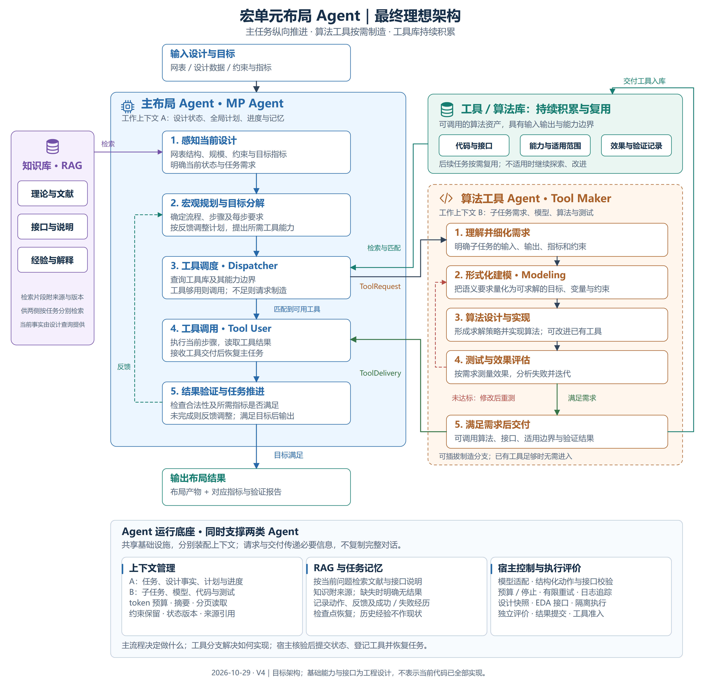

# EDAgent

[Chinese guide](docs/README.zh-CN.md) · [Deployment guide](docs/DEPLOYMENT.md) · [Case coverage](docs/CASE_MATRIX.md) · [Roadmap](#development-roadmap)

EDAgent is a chat workbench for digital chip physical design. Give the main agent a technology-mapped netlist, its physical libraries and timing constraints. The agent inspects the design, selects tools and follows the run through placement and routing. iEDA runs on a Linux worker. The workbench brings back the routed DEF, layout preview, abstract GDS and a report of design-rule violations.

## Run a real design in the workbench

The walkthrough uses **SWERV on Nangate45** (`swerv_nangate45`), a registered design with 6,777 standard cells and three SRAM hard macros. It exercises macro placement, standard-cell placement, clock-tree synthesis and routing. You need a Windows workstation for the UI and SSH access to a worker provisioned with the matching iEDA build, case bundle and libraries.

### 1. Install and open the workbench

On your Windows PC, install Python 3.11+ with the Windows Python launcher, Node.js 24+ with npm, and the Windows OpenSSH client. Download and extract the [source ZIP](https://github.com/EasonGao0728/EDAgent/archive/refs/heads/main.zip), then double-click **Open EDAgent.cmd**. First launch installs the project dependencies and opens the workbench in your browser. Later launches reuse the running service. The authorized worker runs iEDA, so users can use Windows without installing Linux, WSL or Docker.

If Windows marks the downloaded scripts as unsigned, clone the official repository with Git and run the launcher from the clone. On a managed PC, follow your organization's script policy.

For a developer checkout, install Git and run the equivalent commands in PowerShell. With this foreground launch, keep the terminal open.

```powershell
git clone https://github.com/EasonGao0728/EDAgent.git
cd EDAgent
py -3 -m venv .venv-agent
.\.venv-agent\Scripts\python.exe -m pip install -e ".[chatgpt]"
npm.cmd ci --ignore-scripts
npm.cmd start
```

Open [the local workbench](http://127.0.0.1:4173/). In the model connection dialog, enter your provider's base URL, API key, model ID and supported protocol. Use a model that supports tool calls. Keep the key in the connection dialog and out of task messages. The current UI is in Chinese; the control names below are English translations.

### 2. Connect the Linux worker

If your lab already operates a compatible worker, obtain its SSH hostname and provisioned account from the operator. Configure the `eda-worker` SSH alias, verify key-based login, then set the worker account UID and enable the matching `environments/remote-server.json` profile on both hosts. The public profile expects `/srv/edagent/main-agent-remote-v1` as its remote project root. A fresh clone starts with remote execution disabled.

For a new worker, the operator must also provision the pinned native tools, case files and process libraries. The [deployment guide](docs/DEPLOYMENT.md) lists the expected paths, required inputs and connection checks. Once connected, the workbench should show the worker **online** and your chosen case **available**.

### 3. Submit the design and inspect the result

1. Start a new conversation. Open **Select an existing case**, filter by **Full back end**, and select `swerv_nangate45`. Selection binds the server's design package to the conversation.
2. Submit a task such as **“Run the registered SWERV full back end from its mapped netlist. Preserve all three SRAM macros. Deliver the routed DEF, layout preview and DRC report.”**
3. Follow the stage evidence through import, floorplanning, macro and standard-cell placement, clock-tree synthesis, optimization, routing and post-route checks. Use the existing task to inspect progress if a long stage is still running.
4. Open the report and layout preview. Check the hard-macro count, routed DEF readback, abstract GDS verification and remaining DRC violations. A completed flow can still have physical violations. Timing reports without extracted parasitics are diagnostic.

For your own files, **Custom case input** shows the required uploads. Prepare the mapped Verilog, technology LEF, standard-cell and macro LEFs, matching Liberty files, SDC and the design metadata required by the selected profile. Full physical execution currently requires a registered input package. The [case matrix](docs/CASE_MATRIX.md) tracks the 50 development designs individually. Five have full-backend workbench profiles.

## Agent architecture



[Open the original architecture diagram at full resolution](docs/images/agent-architecture.png)

The main placement agent owns the design state and the next decision. Its dispatcher searches the tool library for a suitable operation; the tool user executes it and returns measurements. Context management and retrieval keep the current constraints, relevant tool descriptions and previous results available across stages. When a placement or routing choice needs review, a checkpoint provides a common starting point for comparing candidates.

The figure also shows the target **Algorithm Agent**. When the library lacks a suitable tool, the proposed interface hands this agent a scoped problem, inputs and acceptance criteria. It builds and tests a candidate tool for later reuse. This handoff and tool evolution belong to the later research milestones.

## Development roadmap

| Stage | Planned work | How we will evaluate it |
| --- | --- | --- |
| 1. Reliable end-to-end tool use · active | Make worker setup reproducible, qualify more full-backend profiles, and improve input perception, checkpoint recovery and quality feedback. Package the Windows workbench once a new installation can complete a redistributable case. | On a fresh deployment, submit a mapped netlist from chat and inspect the routed DEF, preview, GDS and quality report. |
| 2. Tool creation from observed gaps | Give the Algorithm Agent a specific operation the dispatcher could not satisfy. Have it build and test a tool against a fixed baseline. | Compare physical metrics and cost on the same inputs and budget, then reuse the accepted tool on another task. |
| 3. Tool evolution and agent self-improvement | Upgrade a tool for new designs and evaluate changes to how the Algorithm Agent proposes and tests tools. | Check held-out designs and previous successes, track regressions and retain rollback to earlier versions. |

The [detailed roadmap](ROADMAP.md) and [qualification records](docs/QUALIFICATION.md) distinguish planned features from measured results.

## Contributing

Release users and contributors use the same workbench. To propose a change, fork the repository, create a branch and open a pull request against `main`. Invited collaborators can create their feature branches directly in this repository. Access to a compute worker is granted separately by its operator.

For a flow or tool issue, include the case ID, process and library revision, failed stage and relevant log excerpt. A new full-flow profile should include input and build hashes, routing evidence, DRC results, DEF readback and GDS verification. Share design files only when you have redistribution rights. EDAgent's original code is covered by the [MIT license](LICENSE); third-party tools and libraries retain their own terms.
